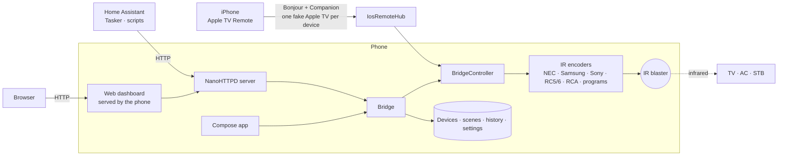

<div align="center">

# 📡 BeamBridge

**Turn an Android phone with an IR blaster into a smart remote and a local-network IR gateway.**

Pair your TV, AC or set-top box once. Control it from the app, a web dashboard, or any script on your Wi-Fi.


[Features](#-features) · [How it works](#-how-it-works) · [Quick start](#-quick-start) · [API](#-http-api) · [Build](#-build) · [Troubleshooting](#-troubleshooting) · [Changelog](#-changelog)

</div>

---

## ✨ Features

### 🎛️ A remote that feels like a remote
- **TV layout out of the box:** mute and power, a big D-pad, volume bar, back / settings / home. It fits one screen with no scrolling.
- **Your keys, your layout:** long-press empty space to edit. Drag keys like app icons, drag the corner to resize them, on a **5 × 8 grid** you can change (3–6 columns, 4–16 rows).
- **Add only what you need:** everything else the remote supports lives in ⋮ → *Add keys to screen*.
- **Swipe D-pad** (swipe for arrows, tap for OK), **favourites** on the home card, haptic and visual send confirmation.
- **Phone volume keys** control the open remote. Press both together to toggle power.
- **Over the lock screen** (on by default; Settings → *Show remote on lock screen*): open a remote, lock the phone, press power, and it's still there. So you don't have to unlock the phone to change the channel.

### 🧭 Pairing that finds the right code
- Pick TV, AC, set-top box or **custom device**; choose the brand; say whether the device is **on or off** and the wizard picks a safe test key (Power, or Volume up).
- Step through every compatible remote, re-test the previous one with a tap, and get a success animation when it works.
- **Don't know the brand? Use the TV finder:** choose a key, BeamBridge fires every code in its database, you tap **STOP** when the TV reacts, then test the last 5 (or the 5 before) and save the winner.

### ❄️ Proper AC control
- Circular **temperature dial** and slider, mode and fan chips, power.
- Shows the saved state and the last command actually sent. IR is one-way, so the AC can never confirm; the app says so plainly.

### 📱 iPhone remote (Apple TV Remote → IR)
- Every device shows up as its **own Apple TV** in the iPhone's Control Center remote: pick *TCL TV* or *Bedroom AC* at the top and control it.
- **You choose what each gesture does.** On a device's remote: ⋮ → *Set up iOS remote*. The screen listens, you swipe or press on the iPhone, then pick the button it should send. Swipe up and the Up arrow are separate gestures, so they can send different buttons.
- Pairs with a **4-digit PIN** you set (Settings → *iPhone remote*). By default only paired iPhones can connect; *Forget all* locks them out again.
- Its own **on/off switch** on the home screen, next to the server. Works without the web server and without any app on the iPhone.

### 🎬 Scenes & macros
- One tap, many commands: *TV power → wait 3 s → HDMI 1 → AC on*. Run from the home screen, the web UI, or `GET /api/scenes/{id}/run`.

### 🌐 Web dashboard & HTTP API
- Everything the app does, in a browser at `http://<phone-ip>:8080`: devices, drag-and-drop remote layout, pairing, finder, scenes, history, settings.
- **API playground** that builds ready-to-copy URL / curl / Home Assistant / fetch snippets.
- Guest access or **username + password** (HTTP Basic auth), choose the listening address and check the port is free before saving.

### 🔍 Debugging made easy
- **Command history:** time, device, key, source (app, web, API, scene) and whether the transmitter accepted it.
- Optional silent notification: *"Power on beamed to Living room TV"*.

### 🎨 Material 3 design
- Follows your wallpaper colours (Material You) or six preset palettes, light / dark / auto, expressive shapes and spring motion.

---

## 🧩 How it works



- **`core/`** is a plain JVM module (no Android): encoders, catalogs, pairing, finder, scenes, the HTTP server and the Apple TV protocol. It is unit-tested on any JDK.
- **`app/`** is the Android shell: Compose UI, the foreground service, the `ConsumerIrManager` emitter.
- The app and the web dashboard talk to the **same `Bridge`**, so a change in one shows up in the other.
- **iPhone remote:** `core/…/atv/` is a Kotlin port of [atv-core](https://github.com/corvofeng/atv-core) (MIT). Each device gets a fake Apple TV: Bonjour records (published with Android's `NsdManager`), PIN pairing (SRP-6a), an encrypted channel (X25519 + Ed25519 + ChaCha20-Poly1305 via BouncyCastle), and the Companion messages for button presses and touchpad strokes. A gesture becomes an `ios_*` id (`ios_swipe_up`, `ios_up`, `ios_select`…), which is looked up in the device's gesture map and sent like any other key. This uses Apple's private protocol, so an iOS update could change it.

---

## 🚀 Quick start

1. **Build or download the APK** (see [Build](#-build)) and install it on a phone that has an IR blaster.
2. Open BeamBridge, go through the 3-screen intro, then **Add device**.
3. Turn on the bridge from the home screen. It shows the address, for example `http://192.168.1.50:8080`. Tap the copy button.
4. Open that address in any browser on the same Wi-Fi, or call a key's URL:

```bash
curl -X POST "http://192.168.1.50:8080/api/blast?device=living_room_tv&button=POWER"
```

> 💡 Long-press any key in the app for **Copy endpoint URL**, favourites, hide and layout options.

### iPhone remote in 4 steps

1. Home screen → turn on **iPhone remote**. Note the PIN on the card (change it in Settings).
2. On the iPhone (same Wi-Fi): Control Center → **Apple TV Remote** → pick your device at the top → enter the PIN. *(No remote icon? iPhone Settings → Control Center → add Apple TV Remote.)*
3. In BeamBridge open that device → ⋮ → **Set up iOS remote**. Swipe or press on the iPhone, pick the button, **Save**. Repeat for each gesture you want.
4. Leave the setup screen. Gestures now send IR.

### Permissions, and why

| Permission | Why | Required? |
|---|---|---|
| Transmit IR | Send commands through the IR blaster | Granted at install |
| Internet / network state | Host the dashboard and API on your Wi-Fi | Granted at install |
| Notifications | Keep the bridge alive in the background and show the "beamed" confirmation | Optional |
| Location | **Only** so Android reveals your Wi-Fi *name* for the dashboard. Your position is never read | Optional |
| Wake lock / Wi-Fi lock | Keep answering requests with the screen off | Granted at install, toggle in Settings |
| Wi-Fi multicast | iPhone remote: keep Bonjour discovery working with the screen off | Granted at install, used only while the iPhone remote is on |

---

## 🔌 HTTP API

Everything in the app is available over HTTP, and the web UI uses only these routes. In password mode every route needs HTTP Basic auth (the password is stored as a salted PBKDF2 hash). Device and button names are case-insensitive.

**Security model.** Scripts, `curl`, Home Assistant and the bundled dashboard can call everything. A *web page from another site* opened in a browser on your network cannot: requests a browser marks as cross-site (`Sec-Fetch-Site` / `Origin`) are refused with 403 for anything that sends IR or changes data, and the API sends no CORS headers. Actions over plain GET links (`/api/blast?...`) are on by default for automations that can only open a URL; turn them off in Settings (`allow_get=false`) to require POST. Until the code database has loaded after a restart, the API answers **503** with `Retry-After`.

| Method | Path | Params | Notes |
|---|---|---|---|
| GET | `/api/status` | | emitter present, `ready`, base URL, auth mode, device count |
| GET / POST | `/api/blast` | `device`, `button` | press a key |
| GET / POST | `/api/raw` | `ir` free text (`NEC 0x20DF10EF 32`, raw µs list, Pronto), or `protocol` + `code` [+ `bits`], `pronto`, `frequency` + `pattern` | send any code |
| GET / POST | `/api/ac` | `device`, optional `power` `mode` `temp` `fan` | validated AC state; 400 if a value isn't supported |
| GET / POST | `/api/devices` | POST: `name`, optional `type`, `button`, `ir` | list / create a custom device |
| GET / POST / DELETE | `/api/devices/{id}` | POST: `name`, `archived`, `swipe` (true/false), `grid_cols`, `grid_rows` | read, edit, delete (also removes its steps from scenes; reports `scenes_updated`) |
| POST / DELETE | `/api/devices/{id}/buttons[/{name}]` | `name` + `ir` (add/edit), `hidden`, `onscreen`, `favorite` (true/false) | edit keys; DELETE of an unknown key is 404 |
| POST | `/api/devices/{id}/tiles/{tile}` | `col`, `row`, `w`, `h` (tile = key name, `@DPAD`, `@VOL`, `@CH`) | move / resize on the grid; 400 on overlap |
| POST | `/api/devices/{id}/tiles/reset` | | default arrangement |
| GET | `/api/catalog/brands` | `type`, `q` | pairing: brands |
| GET | `/api/catalog/candidates` | `type`, `brand`, `on` | pairing: remotes to try |
| POST | `/api/catalog/test` | `type`, `brand`, `index`, `on` | pairing: send the test key |
| GET | `/api/finder`, `/api/finder/keys` | | TV finder state and keys |
| POST | `/api/finder/{start,stop,resume,page,test,accept,reset}` | `key`, `page`, `index`, `device`, `name`, `force` | TV finder; `start` returns 409 if another client (app/web) is running it, unless `force=true` |
| GET / DELETE | `/api/history` | `limit` (1–200) | last commands with source and result |
| GET / POST | `/api/scenes` | JSON `{"name":"Movie night","steps":[{"device":"tv","button":"POWER"},{"wait":3000}]}` or form `name` + `steps=tv:POWER, wait:3000` | list / create |
| GET / POST / DELETE | `/api/scenes/{id}` | same as create | read / edit / delete |
| GET / POST | `/api/scenes/{id}/run`, `/api/scene?name=` | `wait` (default true) | run a scene; returns each step's result. `wait=false` answers 202 at once. Scenes never overlap: a second one waits for the first |
| GET / POST | `/api/settings` | `auth` (guest/password), `username`, `password` (omit to keep), `bind_address`, `port`, `wake_lock`, `auto_start`, `allow_get` | invalid values return 400 and change nothing |
| GET | `/api/network`, `/api/network/check` | `address`, `port` | listening options, port availability |

AC devices take `POWER_ON`, `POWER_OFF`, `TEMP_UP`, `TEMP_DOWN`, `MODE_*` and `FAN_*` through `/api/blast`.

**Home Assistant example**

```yaml
rest_command:
  tv_power:
    url: "http://192.168.1.50:8080/api/blast?device=living_room_tv&button=POWER"
    method: POST
    # username: admin      # if password mode is on
    # password: secret
```

---

## 🛠️ Build

```bash
./gradlew :core:test            # encoders, catalogs, HTTP server (any JDK 17+)
./gradlew :app:assembleDebug    # needs the Android SDK (Android Studio sets it up)
```

The APK lands in `app/build/outputs/apk/debug/`. The GitHub Actions workflow in `.github/workflows/android.yml` runs the same steps on every push, uploads the APKs as artifacts, and publishes them to Releases (see below).

| | |
|---|---|
| Kotlin / AGP / Gradle | 2.2 / 8.11 / 8.14 |
| Compose BOM / Material 3 | 2025.09 / 1.4 |
| compileSdk / minSdk | 36 / 26 |
| Server | NanoHTTPD 2.3.1, kotlinx.serialization |
| iPhone remote crypto | BouncyCastle 1.81 (pure Java) |

### Project layout

```
BeamBridge/
├─ core/                      # JVM module, fully unit-tested
│  └─ src/main/
│     ├─ kotlin/…/ir/         # NEC, Samsung, Sony, RC5/6, RCA, JVC, Panasonic, Sharp, Pronto, AC bytecode programs
│     ├─ kotlin/…/data/       # catalogs, pairing, finder, scenes, history, remote grid, settings
│     ├─ kotlin/…/server/     # Bridge, controller, HTTP server, network helpers
│     ├─ kotlin/…/atv/        # iPhone remote: fake Apple TV (OPACK, TLV8, SRP, Companion session), IosRemoteHub
│     └─ resources/web/       # the web dashboard (single HTML file)
├─ app/                       # Android shell (Compose UI, service, IR emitter)
│  └─ src/main/assets/        # tv_remotes.json, extra_tv_remotes.json, ac_remotes.json, stb_remotes.json
└─ .github/workflows/         # CI: tests + APK build
```

### Datasets (`app/src/main/assets`)

- `tv_remotes.json` (71 brands), `ac_remotes.json`, `stb_remotes.json` (set-top-box providers, extracted from the original `lcndb.db`), plus `extra_tv_remotes.json` (TCL RCA codes) which is merged on load.
- **TV and set-top protocol numbers are their own numbering.** `PROTOCOL_12/13` are RCA (TCL, VU, Micromax, Akai…), `5/10` are RC5, and 0/1/2/6/7/8 are NEC/RC5/RC6/Samsung/Sony/Panasonic. Numbers with no known definition (3, 4, 9, 11, 14, 15, 16, 17, 18) are hidden from pairing and the finder rather than sent with a guessed waveform. Earlier builds wrongly rendered them with AC protocol programs.
- Each AC remote carries its protocol *program*, a small bytecode that renders a frame into pulses (`IrProgram`).
- AC remotes store a full POWER frame plus XOR deltas for mode, temperature and fan. Frames keep their full bit width. **AC output is not yet verified on a real AC.**
- Saved files are written crash-safe (temp file, fsync, rename). A file that can't be read is kept as `<name>.corrupt-<time>` instead of being overwritten.

---

### Releases

GitHub Actions (`.github/workflows/android.yml`) runs the tests and builds the APK on every push and pull request. What lands on the **Releases** page depends on how the build started:

| You do | You get | Release notes |
|---|---|---|
| Push to `main` | The **nightly** pre-release is replaced by the new APK, so there's only ever one nightly | The CHANGELOG section only |
| Actions → **Build APK** → **Run workflow** | A real release `v<baseVersion>.<run number>`, marked *Latest* | CHANGELOG section + GitHub's auto notes (merged pull requests and a *Full Changelog* compare link) |
| Push a tag such as `v1.7` or `v1.7.0` | A real release named after the tag, marked *Latest* | Same as above |
| Open a pull request | Tests and APK as build artifacts, no release | – |

**For a new feature round:** bump `baseVersion` in `app/build.gradle.kts` and add a `## <baseVersion>` section (e.g. `## 1.7`) at the top of [CHANGELOG.md](CHANGELOG.md). The workflow picks the section that matches the version, dropping trailing numbers until one matches (`1.7.12` → `1.7`). If none matches, the notes just say "Automated build". APKs are signed with the debug key so they install without setup; swap in a real keystore before publishing to a store.

## 🩺 Troubleshooting

| Symptom | Likely cause and fix |
|---|---|
| Sends "OK" but the device does nothing (Xiaomi / Poco / Redmi) | Qualcomm IR drivers drop odd-length pulse arrays. BeamBridge always ends a burst with a 10 ms space, like Mi Remote. Make sure you're on a recent build, and check the command shows as sent in **History**. |
| Dashboard shows only "Wi-Fi", not the network name | Grant the optional Location permission (home screen → *Show my Wi-Fi name*), and keep device location on. |
| "Waiting for Wi-Fi" on the status card | Address is set to Automatic and no LAN is connected. It starts listening as soon as one appears. |
| Remote disappears when locked | Keep the remote open when you lock. Settings → *Show remote on lock screen* must be on. |
| A brand's codes don't react (e.g. TCL from the dataset) | Fixed in 1.6: TV `PROTOCOL_n` codes were sent with an AC waveform. Re-pair, or just update: saved devices pick up the fix automatically. Brands whose protocol is still unknown are hidden; use the TV finder. |
| The remote is on the lock screen but I can't edit keys | On purpose: over the lock screen keys only send. Unlock to edit, delete or copy URLs. |
| An automation gets 403 | It looks like a browser page from another site. Call the API from a script or Home Assistant, or from the dashboard itself. |
| An automation gets 405 on a GET link | *Allow actions from simple GET links* is off in Settings. Turn it on or use POST. |
| "Allow" notifications does nothing | Android blocks the dialog after a denial; the button then opens the app's notification settings. |
| Port busy / can't start | Pick another port in Settings → Network and use **Check**. |
| Can't reach the dashboard from another device | Same Wi-Fi? Phone not in battery saver? Try the address shown on the status card. Guest isolation on some routers blocks it. |
| iPhone doesn't list the device in Apple TV Remote | iPhone remote switch on? Same Wi-Fi (not guest, no "AP/client isolation")? Device not archived or hidden (Settings → *iPhone remote*)? Turning Wi-Fi off/on on the phone running BeamBridge re-announces it. |
| iPhone says the PIN is wrong | Use the PIN on the home card / Settings. Changing the PIN only affects new pairings. |
| iPhone was paired but now won't connect | It was forgotten (Settings → *Forget all*) or this device's data was reset: on the iPhone, pick the device again and enter the PIN. If it still fails after an iOS update, try turning off *Only paired iPhones*. |
| A gesture does nothing | It isn't set up for that device (the home card says "not set up"). ⋮ → *Set up iOS remote*. A tap and a click are different gestures (*Tap* vs *Select*). |
| AC shows a different state than reality | IR is one-way. Set the AC once with its real remote, or send the state again. |

---

## 🗺️ Roadmap

- Verify AC frames against real units and add checksum handling for non-default modes
- Convert the remaining protocols to carrier-cycle timings
- Home-screen widgets and quick-settings tiles for favourite keys
- iPhone remote: hold-to-repeat (volume), run a scene from a gesture, gesture setup in the web dashboard

---

## 📜 Changelog

> This section is updated with every release.

### Round 7 (current): iPhone remote, see [CHANGELOG.md](CHANGELOG.md)
- Each device appears as its own Apple TV in the iPhone's Control Center remote; gestures are learned per device and send IR
- PIN pairing with paired-only access, iPhone remote switch on the home screen, settings section; releases section and tag notes fixed

### Round 6: audit fixes, see [CHANGELOG.md](CHANGELOG.md)
- TV protocol numbering fixed (TCL/VU/Micromax/Akai codes now RCA), crash-safe storage, startup ready signal, CSRF-proof API with hashed password, lock-screen read-only mode, scene queue, finder ownership, batched history, nightly releases, lcndb.db replaced by a 320 KB JSON

### Round 5: see [CHANGELOG.md](CHANGELOG.md), which is also the text of each GitHub Release
- Onboarding "Allow notifications" fixed (falls back to app notification settings); remote shows over the lock screen by default
- Whole TV dataset verified by tests; releases with APK + notes published automatically from CI

### Round 4
- **IR compatibility fix for Qualcomm phones** (even-length patterns, carrier-cycle NEC/Samsung timings, AC frame width)
- **Movable and resizable remote grid** (5 × 8 default, customisable) in the app and the web dashboard
- **Command history**, **scenes & macros**, "beamed" notification, first-run **onboarding** with a permissions explainer
- Dashboard: prominent status card, copy address, Wi-Fi name (optional location permission), device count, expandable errors
- Remote: send feedback and indicator, favourites, long-press tip. AC: circular dial, slider, saved vs last sent
- Pairing: unknown-brand shortcut, re-test previous code, success animation
- Web: connection bar, device search, API playground, keyboard navigation, safe-area handling
- Fixes: wake lock applies live, case-insensitive IDs and 404 on missing key delete, strict settings validation, strict AC validation, "auto" bind waits instead of binding everywhere, toggle bit only advances after a successful send

### Round 3
- Default remote of fixed keys with *Add keys to screen*, swipe D-pad, phone volume keys, lock-screen mode, Material 3 colour themes

### Round 2
- Web UI parity with the app, TV finder, archive / hide / move, web access settings (guest or password, bind address check), TCL RCA codes

### Round 1
- Core engine, HTTP server, Compose app, GitHub Actions build

---

<div align="center">Built with Kotlin, Jetpack Compose and a lot of infrared 🔴</div>
